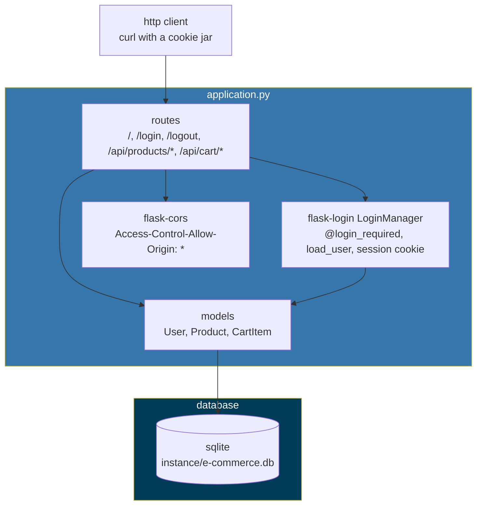

<div align="center">

<pre>
 ┌────────────────────────────────────────────────────┐
 │  user@dev:~/projects$ ./e-commerce                 │
 │                                                    │
 │      ███████╗  ██╗  ██╗   ██████╗   ██████╗        │
 │      ██╔════╝  ██║  ██║  ██╔═══██╗  ██╔══██╗       │
 │      ███████╗  ███████║  ██║   ██║  ██████╔╝       │
 │      ╚════██║  ██╔══██║  ██║   ██║  ██╔═══╝        │
 │      ███████║  ██║  ██║  ╚██████╔╝  ██║            │
 │      ╚══════╝  ╚═╝  ╚═╝   ╚═════╝   ╚═╝            │
 │                                                    │
 │  > products and a cart · flask + sqlite            │
 └────────────────────────────────────────────────────┘
</pre>


</div>

---

## `$ cat about.txt`

```
e-commerce is a rest api for a small shop: a product catalog, a login
and one shopping cart per user, stored in sqlite.

everything lives in application.py — three flask-sqlalchemy models
(User, Product, CartItem) and one function per route. flask-login keeps
the user in a signed session cookie, so after POST /login the cart
routes read current_user instead of taking a user id. a cart item is
just a (user_id, product_id) row, and checkout deletes those rows.

built as a hands-on study of python, flask, sqlalchemy and session
auth with flask-login.
```

## `$ ls features/`

```
[x] products: list, get by id, add, partial update, delete
[x] login / logout with a flask-login session cookie
[x] cart per user: add, remove, view with name and price, checkout
[x] product writes and every cart route require login
[x] the sqlite schema ships in instance/e-commerce.db
[x] swagger 2.0 spec of the api in swagger.yaml
[ ] crashes on import — line 12 calls init_application, not init_app
[ ] flask 2.3.0 does not start on python 3.14 (pkgutil.get_loader)
[ ] relative sqlite path — run from the repo root, or flask makes an empty db
[ ] no sign-up route — users have to be inserted into the db by hand
[ ] plain-text passwords; a user with a null password logs in without one
[ ] any logged-in user can add, edit or delete products — no roles
[ ] no session means a 302 to /login, not a 401
[ ] no price check — negatives pass, a non-numeric price is a 500
[ ] a product deleted while in a cart makes GET /api/cart a 500
[ ] checkout only empties the cart — no order, no total
[ ] debug=True — every 500 is the werkzeug debugger page, not json
[ ] swagger.yaml is stale: no /api/products/search, remove takes a product id
[ ] hardcoded SECRET_KEY, no tests
```

## `$ cat stack.lock`

```
runtime     python 3.13 (flask 2.3.0 breaks on 3.14)
framework   flask 2.3.0 + werkzeug 2.3.0
database    sqlite via flask-sqlalchemy 3.1.1 (instance/e-commerce.db)
auth        flask-login 0.6.2, signed session cookie
cors        flask-cors 3.0.10, every origin allowed
docs        swagger.yaml (swagger 2.0), not served by the app
infra       none, runs locally
tests       none yet
tooling     pip + venv, curl
```

## `$ cat architecture.mmd`



## `$ ./install.sh`

```bash
# clone
git clone https://github.com/miguelcrwz/e-commerce.git
cd e-commerce

# dependencies — flask 2.3.0 does not start on python 3.14, use 3.13
# (windows: py -3.13 -m venv .venv, then .venv\Scripts\activate)
python3.13 -m venv .venv && source .venv/bin/activate
pip install -r requirements.txt

# the schema ships in instance/e-commerce.db with empty tables.
# there is no sign-up route, so insert a user by hand (plain text)
python -m sqlite3 instance/e-commerce.db "INSERT INTO user (username, password) VALUES ('miguel', '1234')"
```

## `$ ./run`

```bash
# development (from the repo root) — the flask debug server (debug=True)
python application.py
```

```
Traceback (most recent call last):
  File ".../e-commerce/application.py", line 12, in <module>
    login_manager.init_application(application)
    ^^^^^^^^^^^^^^^^^^^^^^^^^^^^^^
AttributeError: 'LoginManager' object has no attribute 'init_application'
```

```bash
# known bug: LoginManager has init_app, not init_application.
# patch line 12 locally until the fix lands, then start it again
python -c "from pathlib import Path; p = Path('application.py'); p.write_bytes(p.read_bytes().replace(b'init_application', b'init_app'))"
python application.py
```

```
 * Serving Flask app 'application'
 * Debug mode: on
WARNING: This is a development server. Do not use it in a production ...
 * Running on http://127.0.0.1:5000
Press CTRL+C to quit
 * Restarting with stat
 * Debugger is active!
 * Debugger PIN: ...
```

## `$ ./e-commerce --routes`

```
method  path                       auth    description
──────  ─────────────────────────  ──────  ───────────────────────────────
GET     /                          public  health check, answers API UP
POST    /login                     public  start a session cookie
POST    /logout                    login   end the session
GET     /api/products              public  every product: id, name, price
GET     /api/products/{id}         public  one product, with description
POST    /api/products/add          login   add a product (name + price)
PUT     /api/products/update/{id}  login   change only the fields sent
DELETE  /api/products/delete/{id}  login   delete a product
POST    /api/cart/add/{id}         login   add one unit of product {id}
DELETE  /api/cart/remove/{id}      login   remove one unit of product {id}
GET     /api/cart                  login   your cart, with name and price
POST    /api/cart/checkout         login   empty your cart
```

```
200  every success — writes answer {"message": "..."}, never 201
302  @login_required route without a session — redirect to
     /login?next=<path>, and following it is a 405 (/login is POST only)
400  product without name or price, unknown product on cart add,
     product not in the cart on remove, or malformed json
     (malformed json and 415 get flask's html error page, not json)
401  wrong username or password on POST /login
404  product id does not exist (details, update, delete)
415  the body is not sent as application/json
500  a json list on /login, a null body, a null or non-numeric price,
     or a cart that still holds a deleted product — with debug=True
     every 500 is the werkzeug debugger page (traceback + console)
```

## `$ describe User Product CartItem`

```
User
id           Integer      primary key
username     String(80)   required, unique
password     String(80)   plain text, nullable
cart         relation     list of CartItem, backref user

Product
id           Integer      primary key
name         String(120)  required
price        Float        required, no range check, coerced with float()
description  Text         optional — POST /api/products/add stores "" if omitted

CartItem
id           Integer      primary key, one row per unit added
user_id      Integer      fk user.id, taken from the session
product_id   Integer      fk product.id, not enforced — survives a product delete
```

## `$ curl -i`

```bash
# log in — the session cookie lands in cookies.txt
curl -i -c cookies.txt -X POST http://127.0.0.1:5000/login \
  -H "Content-Type: application/json" \
  -d '{"username":"miguel","password":"1234"}'
```

```
HTTP/1.1 200 OK
{
  "message": "Logged in successfully."
}
```

```bash
# add a product
curl -i -b cookies.txt -X POST http://127.0.0.1:5000/api/products/add \
  -H "Content-Type: application/json" \
  -d '{"name":"notebook","price":4599.90,"description":"dell 15"}'
```

```
HTTP/1.1 200 OK
{
  "message": "Product registered successfully."
}
```

```bash
# put it in the cart twice — every add is a new row
curl -i -b cookies.txt -X POST http://127.0.0.1:5000/api/cart/add/1
curl -i -b cookies.txt -X POST http://127.0.0.1:5000/api/cart/add/1
```

```
HTTP/1.1 200 OK
{
  "message": "Item added to the cart successfully."
}

HTTP/1.1 200 OK
{
  "message": "Item added to the cart successfully."
}
```

```bash
# read the cart
curl -i -b cookies.txt http://127.0.0.1:5000/api/cart
```

```
HTTP/1.1 200 OK
[
  {
    "id": 1,
    "product_id": 1,
    "product_name": "notebook",
    "product_price": 4599.9,
    "user_id": 1
  },
  {
    "id": 2,
    "product_id": 1,
    "product_name": "notebook",
    "product_price": 4599.9,
    "user_id": 1
  }
]
```

```bash
# no cookie — a redirect to /login instead of a 401
curl -i http://127.0.0.1:5000/api/cart
```

```
HTTP/1.1 302 FOUND
Location: /login?next=%2Fapi%2Fcart
```

```bash
# missing price
curl -i -b cookies.txt -X POST http://127.0.0.1:5000/api/products/add \
  -H "Content-Type: application/json" \
  -d '{"name":"mouse"}'
```

```
HTTP/1.1 400 BAD REQUEST
{
  "message": "Invalid product data."
}
```

```bash
# delete the product while it is still in the cart, then read the cart.
# the 500 is the werkzeug debugger page (html), not json
curl -i -b cookies.txt -X DELETE \
  http://127.0.0.1:5000/api/products/delete/1
curl -i -b cookies.txt http://127.0.0.1:5000/api/cart
```

```
HTTP/1.1 200 OK
{
  "message": "Product deleted successfully."
}

HTTP/1.1 500 INTERNAL SERVER ERROR
Content-Type: text/html; charset=utf-8

<!doctype html>
<html lang=en>
  <head>
    <title>AttributeError: 'NoneType' object has no attribute 'name'
 // Werkzeug Debugger</title>
...
```

## `$ cat session.flow`

```
POST /login {"username", "password"}
  │
  ├─ username not found ─────────────────────> 401
  ├─ password != user.password (plain text) ─> 401
  └─ ok ─> login_user() ─> signed cookie ────> 200

any @login_required route
  │
  ├─ no cookie ─> 302 /login?next=<path> ────> GET there is a 405
  └─ cookie ok ─> load_user(id) ─────────────> handler, with current_user
```

## `$ tree`

```
e-commerce/
├── application.py      # config, models, user_loader and every route
├── instance/
│   └── e-commerce.db   # sqlite file with the three empty tables
├── swagger.yaml        # swagger 2.0 spec, not served by the app
├── requirements.txt    # the flask 2.3.0 stack, pinned
├── .gitignore
├── LICENSE
└── README.md
```

## `$ git log --oneline roadmap`

```
a1b2c3d  fix init_app and bump flask so it starts on python 3.14
e4f5g6h  swap Query.get for db.session.get (LegacyAPIWarning)
i7j8k9l  add POST /users and hash passwords with werkzeug.security
m0n1o2p  answer 401 json instead of redirecting to /login
q3r4s5t  validate bodies and drop cart rows when a product is deleted
u6v7w8x  pytest suite with the flask test client
```

## `$ cat LICENSE | head -1`

```
MIT © 2026 Miguel Cruz
```

## `$ whoami`

```
miguel cruz
├── github    https://github.com/miguelcrwz
├── linkedin  https://linkedin.com/in/miguelcrwz
└── email     miguwlcrwz@gmail.com
```

<div align="center">

<pre>
$ exit
[process exited with code 0]
</pre>

</div>
